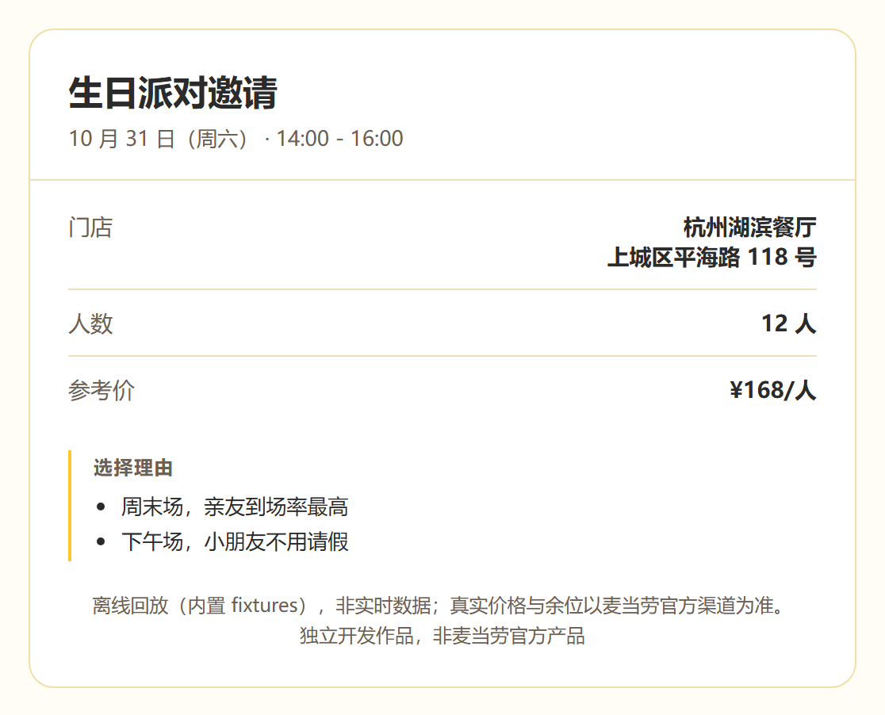

# 麦麦派对策划师

[](https://github.com/cccsrff/mcd-party-planner/actions/workflows/ci.yml)
[](./LICENSE)

麦当劳 MCP 开放了 33 个工具，其中只有 5 个属于**主题活动（派对）**，而它是唯一需要 4 次串行查询才能得出结论的链路：城市 → 门店 → 日期 → 场次。官方示例集中在点餐、省钱、活动推荐，都不涉及派对。

这个 Skill 把 4 次查询压成 1 条命令，给出选场结论与理由，并生成一张可转发的邀请函。下单独立成第 2 条命令，默认 dry-run。



<sub>上图由 `mcdparty demo --format html` 渲染，用的是内置演示数据。</sub>

## 为什么是派对

- **决策最长**：4 个维度、多个候选，人工比场次的成本最高
- **示例最少**：33 个工具里派对只占 5 个，官方三个示例方向都不覆盖
- **有交付物**：最终产物是一张能发给家人的邀请函，不只是一段 JSON

## 快速开始（不需要 Token）

```bash
git clone https://github.com/cccsrff/mcd-party-planner.git
cd mcd-party-planner
python -m mcdparty demo
```

输出：

```text
# 生日派对策划案

- 城市：杭州
- 门店：杭州湖滨餐厅（上城区平海路 118 号）
- 日期：10 月 31 日（周六）
- 场次：14:00 - 16:00
- 人数：12 人
- 参考价：¥168/人

## 选择理由

- 门店取列表首家「杭州湖滨餐厅」（当前未按距离或评分排序，3 家可选）
- 自动选定最近周末 2026-10-31（共 5 天可约，全部是周末）
- 周末场，亲友到场率最高
- 下午场，适合小朋友作息
- 容量 20 人 ≥ 预计 12 人
```

完整输出见 [demo/demo.md](demo/demo.md)。

这是**离线回放**：内置 fixtures 复刻了 MCP 响应结构，只覆盖杭州 1 城 3 店 1 组日期，不联网、不下单。生成邀请函：

```bash
python -m mcdparty demo --format html -o invite.html
```

装成命令（可选，要求 Python 3.9+，无第三方依赖）：

```bash
pip install .      # 之后可直接用 mcdparty 代替 python -m mcdparty
```

## 接入真实 MCP

1. 打开 [open.mcd.cn/mcp](https://open.mcd.cn/mcp)，手机号登录 → 右上角「控制台」→ 点「激活」→ 同意协议 → 复制 Token（免费）
2. 写入环境变量：

```bash
export MCD_MCP_TOKEN="你的 Token"
```

3. 查真实数据：

```bash
python -m mcdparty plan --city 杭州 --size 12
python -m mcdparty plan --city 杭州 --date 2026-11-08 --format html -o invite.html
```

本项目本身是一个 MCP **客户端**。你也可以在自己常用的 MCP 客户端里直接挂麦当劳 MCP（见 [mcp-config.example.json](mcp-config.example.json)），但那样拿到的是 33 个原始工具，没有这里的 4 步编排与场次评分。

## 命令

| 命令 | 作用 |
| --- | --- |
| `python -m mcdparty tools` | 列出 MCP 全部工具（连通性自检） |
| `python -m mcdparty cities --keyword 杭州` | 查询可办派对的城市 |
| `python -m mcdparty plan --city 杭州 --size 12` | 4 次查询 + 选场结论，输出 markdown / json / html |
| `python -m mcdparty book --city 杭州 --date 2026-11-08 --size 12` | 下单，默认 dry-run |
| `python -m mcdparty demo` | 离线回放，无网络无 Token |

## 它做什么，不做什么

场次评分的规则是明确的，写在 [planner.py](mcdparty/planner.py)，每条推荐都附理由：

| 条件 | 分值 |
| --- | --- |
| 周末场 | +3 |
| 生日/家庭 + 下午场，团建 + 傍晚场 | +2 |
| 容量 ≥ 预计人数 | +2（不足则 -5） |
| 人均价 ≤ 预算 | +1（超出则 -3） |

**门店与日期没有评分**：门店取列表首家，日期取最近周末，理由是简单启发式，代码与输出文案都如实标注。补门店排序是下一步计划。

安全边界：

- `plan` 只查询，从不下单；`book` 默认 dry-run，不加 `--confirm` 不碰下单接口
- 指定日期不可约时**直接报错**，不会悄悄改期
- `--session` 锁定场次 ID，跳过重新评分——看到哪场就订哪场
- 城市不在可办列表时直接报错，不会替你换到别的城市
- 离线回放时若录制参数与请求不符，直接报错，不会拿杭州的数据回答北京

## 下单前需要知道

- `party-order-create` 只提交门店、日期、场次、人数，不含联系人与支付信息；订单状态与支付方式以麦当劳返回为准
- 麦当劳 MCP 有 `cancel-order`，本项目**尚未接入**取消流程
- 相比直接用麦当劳 App：本项目会跨门店比较场次并解释推荐理由，还会生成邀请函；订座能力本身双方一致

## 测试

```bash
python -m unittest discover -s tests
```

39 个用例，全部离线（无网络、无 Token），每次 push 由 GitHub Actions 在 Python 3.9 与 3.12 上各跑一遍。覆盖 MCP 协议握手与 SSE 解析、401/429 映射、选场决策、严格日期、场次锁定、回放参数校验、离线产物不得自称实时数据。

## 项目结构

```text
mcdparty/
  mcp_client.py   MCP Streamable-HTTP 客户端（JSON-RPC 2.0，纯标准库）
  planner.py      4 步查询 + 场次评分
  render.py       markdown / json / html
  replay.py       离线回放传输层（含 fixtures 参数校验）
  record.py       录制真实响应为 fixtures
  chat.py         可选的 LLM 工具调用模式
  cli.py          命令行入口
tests/            39 个用例 + fixtures
skill/SKILL.md    WorkBuddy Skill 打包
```

完整的 MCP 集成细节（Tool 清单、调用链、错误映射、录制回放）见 [MCP_INTEGRATION.md](MCP_INTEGRATION.md)。

## 参赛信息

本仓库是 1024 程序员节 · 麦当劳程序员创意开发大赛参赛作品，使用 WorkBuddy 开发。参赛声明见 [CONTEST_DECLARATION.md](CONTEST_DECLARATION.md)。

## 限制与声明

- 真实可约城市、门店、场次以 MCP 接口实时返回为准；内置 fixtures 只是杭州的一组示例
- 本项目为独立开发作品，非麦当劳官方产品；价格与余位以麦当劳官方渠道为准
- 使用麦当劳 MCP 服务须遵守 [MCP 服务规则](https://cdn.mcd.cn/cms/pages/MCPServerRules.html)

MIT License
